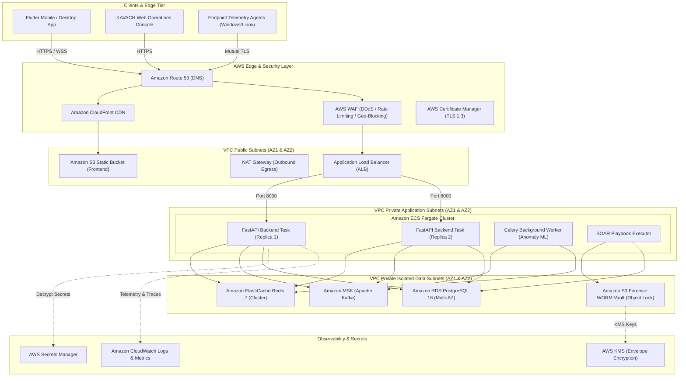

# KAVACH Sovereign SOAR-XDR: Enterprise AWS Production Deployment Guide

**Target Environment:** Amazon Web Services (AWS) Production Architecture  
**Classification:** High-Availability, Zero-Trust, Sovereign Defense Infrastructure  
**Compliance Standards:** CERT-In Cyber Security Directions (Section 70B), ISO 27001, SOC 2 Type II  
**Last Updated:** October 2026

---

## Table of Contents
1. [Executive Architecture Overview](#1-executive-architecture-overview)
2. [End-to-End Architecture Diagram](#2-end-to-end-architecture-diagram)
3. [Prerequisites & Initial Setup](#3-prerequisites--initial-setup)
4. [Phase 1: VPC & Zero-Trust Network Topology](#4-phase-1-vpc--zero-trust-network-topology)
5. [Phase 2: Managed Data Stores (RDS, Redis, MSK Kafka)](#5-phase-2-managed-data-stores-rds-redis-msk-kafka)
6. [Phase 3: Backend Containerization & Amazon ECR Registry](#6-phase-3-backend-containerization--amazon-ecr-registry)
7. [Phase 4: ECS Fargate Container Service & Task Definitions](#7-phase-4-ecs-fargate-container-service--task-definitions)
8. [Phase 5: Application Load Balancer, SSL/TLS (ACM) & AWS WAF](#8-phase-5-application-load-balancer-ssltls-acm--aws-waf)
9. [Phase 6: Static Frontend Deployment via S3 & Amazon CloudFront](#9-phase-6-static-frontend-deployment-via-s3--amazon-cloudfront)
10. [Phase 7: Mobile App Production Build & Signing (Flutter APK / AAB)](#10-phase-7-mobile-app-production-build--signing-flutter-apk--aab)
11. [Phase 8: Security, CERT-In Forensic Compliance & Audit Logging](#11-phase-8-security-cert-in-forensic-compliance--audit-logging)
12. [Phase 9: Post-Deployment Smoke Tests & Verification Runbook](#12-phase-9-post-deployment-smoke-tests--verification-runbook)

---

## 1. Executive Architecture Overview

KAVACH is architected as a sovereign, multi-tier cyber-security operations platform designed to ingest, process, correlate, and automatically contain endpoint and network threats. 

### Core Components
- **API Core & Telemetry Gateway:** High-performance asynchronous FastAPI microservice cluster handling REST endpoints and persistent WebSockets for live telemetry.
- **Asynchronous Event Pipeline:** Celery workers powered by Amazon MSK (Managed Streaming for Apache Kafka) and Amazon ElastiCache Redis for distributed anomaly scoring and MITRE ATT&CK correlation.
- **Machine Learning Behavioral Engine:** Scikit-learn IsolationForest ML and Spam/Scam Telemetry Sentinels containerized within worker instances.
- **State & Audit Vault:** Amazon RDS PostgreSQL (Multi-AZ) storing user identities, device enrollment records, alert histories, and Merkle hash-chained immutable audit ledgers.
- **Frontend Presentation Layer:** Amazon S3 static bucket distributed through Amazon CloudFront edge nodes with strict Content Security Policy (CSP).
- **Mobile Client:** Cross-platform Flutter application connected to WebSocket streaming and REST endpoints with SSL certificate pinning.

---

## 2. End-to-End Architecture Diagram



---

## 3. Prerequisites & Initial Setup

Ensure you have the following installed and configured on your administration workstation:

```bash
# Verify AWS CLI v2
aws --version
# Configure AWS CLI profile with administrative credentials
aws configure --profile kavach-prod

# Verify Docker engine
docker --version

# Verify Flutter SDK (for mobile releases)
flutter doctor

# Set default region (e.g., ap-south-1 for Mumbai / India sovereign residency)
export AWS_REGION="ap-south-1"
export AWS_PROFILE="kavach-prod"
export ENVIRONMENT="production"
```

---

## 4. Phase 1: VPC & Zero-Trust Network Topology

Create a high-security VPC with 2 Availability Zones, 2 Public subnets, 2 Private Application subnets, and 2 Isolated Database subnets.

### 4.1 Subnet Architecture
| Subnet Name | CIDR Block | Route | Purpose |
| :--- | :--- | :--- | :--- |
| `kavach-public-1a` | `10.0.1.0/24` | Internet Gateway (IGW) | Application Load Balancer, NAT Gateway |
| `kavach-public-1b` | `10.0.2.0/24` | Internet Gateway (IGW) | Application Load Balancer (Redundancy) |
| `kavach-private-app-1a`| `10.0.10.0/24` | NAT Gateway | ECS Fargate Tasks (FastAPI API) |
| `kavach-private-app-1b`| `10.0.11.0/24` | NAT Gateway | ECS Fargate Tasks (Celery Workers) |
| `kavach-isolated-db-1a`| `10.0.20.0/24` | Local VPC Only | RDS PostgreSQL Primary |
| `kavach-isolated-db-1b`| `10.0.21.0/24` | Local VPC Only | RDS PostgreSQL Standby, ElastiCache Redis |

### 4.2 Security Groups Configuration
1. **ALB Security Group (`kavach-alb-sg`):**
   - Inbound: Port 80 (HTTP redirect), Port 443 (HTTPS) from `0.0.0.0/0`.
   - Outbound: Port 8000 to `kavach-ecs-sg`.
2. **ECS Fargate Security Group (`kavach-ecs-sg`):**
   - Inbound: Port 8000 only from `kavach-alb-sg`.
   - Outbound: Port 5432 to `kavach-db-sg`, Port 6379 to `kavach-redis-sg`, Port 9092 to `kavach-msk-sg`, Port 443 to VPC Endpoints (Secrets Manager, S3, CloudWatch).
3. **Database Security Group (`kavach-db-sg`):**
   - Inbound: Port 5432 only from `kavach-ecs-sg`.
   - Outbound: None (Isolated).

---

## 5. Phase 2: Managed Data Stores (RDS, Redis, MSK Kafka)

### 5.1 Amazon RDS PostgreSQL 16 (Multi-AZ)
```bash
# 1. Create DB Subnet Group
aws rds create-db-subnet-group \
    --db-subnet-group-name kavach-db-subnet-group \
    --db-subnet-group-description "Isolated subnets for KAVACH Postgres database" \
    --subnet-ids "subnet-isolated-1a" "subnet-isolated-1b"

# 2. Provision Multi-AZ PostgreSQL 16 Instance with Storage Auto-scaling and Encryption
aws rds create-db-instance \
    --db-instance-identifier kavach-prod-postgres \
    --db-instance-class db.m6g.xlarge \
    --engine postgres \
    --engine-version 16.2 \
    --allocated-storage 100 \
    --max-allocated-storage 1000 \
    --storage-type gp3 \
    --master-username kavach_admin \
    --master-user-password "ReplaceWithAWSSecretsManagerVaultPassword!" \
    --db-subnet-group-name kavach-db-subnet-group \
    --vpc-security-group-ids "sg-kavach-db" \
    --multi-az \
    --storage-encrypted \
    --backup-retention-period 30 \
    --deletion-protection \
    --auto-minor-version-upgrade
```

### 5.2 Amazon ElastiCache Redis 7 (Cluster Mode)
```bash
# Provision ElastiCache Redis cluster for fast session state, OTP validation, and caching
aws elasticache create-replication-group \
    --replication-group-id kavach-prod-redis \
    --replication-group-description "KAVACH distributed cache and OTP state" \
    --engine redis \
    --engine-version 7.1 \
    --cache-node-type cache.m6g.large \
    --num-node-groups 2 \
    --replicas-per-node-group 1 \
    --automatic-failover-enabled \
    --transit-encryption-enabled \
    --at-rest-encryption-enabled \
    --cache-subnet-group-name kavach-redis-subnets \
    --security-group-ids "sg-kavach-redis"
```

---

## 6. Phase 3: Backend Containerization & Amazon ECR Registry

### 6.1 Create Amazon ECR Repository
```bash
aws ecr create-repository \
    --repository-name kavach-backend \
    --image-scanning-configuration scanOnPush=true \
    --encryption-configuration encryptionType=KMS
```

### 6.2 Production Backend Dockerfile (`c:\KAVACH\backend\Dockerfile.prod`)
```dockerfile
# Multi-stage production container for KAVACH FastAPI backend
FROM python:3.12-slim AS builder

WORKDIR /app
ENV PYTHONDONTWRITEBYTECODE=1 \
    PYTHONUNBUFFERED=1

RUN apt-get update && apt-get install -y --no-install-recommends \
    build-essential \
    libpq-dev \
    curl \
    && rm -rf /var/lib/apt/lists/*

COPY requirements.txt .
RUN pip install --no-cache-dir --upgrade pip && \
    pip install --no-cache-dir -r requirements.txt

FROM python:3.12-slim AS runtime

WORKDIR /app
ENV PATH="/app/.venv/bin:$PATH" \
    ENVIRONMENT=production

RUN apt-get update && apt-get install -y --no-install-recommends \
    libpq5 \
    curl \
    && rm -rf /var/lib/apt/lists/*

# Add non-root system user for least privilege security
RUN useradd -u 10001 -m -s /bin/bash kavach
USER kavach

COPY --from=builder /usr/local/lib/python3.12/site-packages /usr/local/lib/python3.12/site-packages
COPY --from=builder /usr/local/bin /usr/local/bin
COPY --chown=kavach:kavach . .

EXPOSE 8000

HEALTHCHECK --interval=15s --timeout=5s --start-period=10s --retries=3 \
  CMD curl -f http://localhost:8000/api/v1/health || exit 1

CMD ["uvicorn", "app.main:app", "--host", "0.0.0.0", "--port", "8000", "--workers", "4", "--proxy-headers", "--forwarded-allow-ips", "*"]
```

### 6.3 Build & Push to Amazon ECR
```bash
# Log in to ECR
aws ecr get-login-password --region $AWS_REGION | docker login --username AWS --password-stdin $(aws sts get-caller-identity --query Account --output text).dkr.ecr.$AWS_REGION.amazonaws.com

# Build and tag image
ACCOUNT_ID=$(aws sts get-caller-identity --query Account --output text)
ECR_URI="$ACCOUNT_ID.dkr.ecr.$AWS_REGION.amazonaws.com/kavach-backend:latest"

docker build -t kavach-backend:latest -f c:\KAVACH\backend\Dockerfile.prod c:\KAVACH\backend
docker tag kavach-backend:latest $ECR_URI
docker push $ECR_URI
```

---

## 7. Phase 4: ECS Fargate Container Service & Task Definitions

### 7.1 ECS Task Definition (`kavach-task-def.json`)
```json
{
  "family": "kavach-prod-backend",
  "networkMode": "awsvpc",
  "requiresCompatibilities": ["FARGATE"],
  "cpu": "2048",
  "memory": "4096",
  "executionRoleArn": "arn:aws:iam::ACCOUNT_ID:role/ecsTaskExecutionRole",
  "taskRoleArn": "arn:aws:iam::ACCOUNT_ID:role/kavachAppTaskRole",
  "containerDefinitions": [
    {
      "name": "kavach-api",
      "image": "ACCOUNT_ID.dkr.ecr.ap-south-1.amazonaws.com/kavach-backend:latest",
      "essential": true,
      "portMappings": [
        {
          "containerPort": 8000,
          "protocol": "tcp"
        }
      ],
      "secrets": [
        {
          "name": "DATABASE_URL",
          "valueFrom": "arn:aws:secretsmanager:ap-south-1:ACCOUNT_ID:secret:kavach/prod/database-url"
        },
        {
          "name": "REDIS_URL",
          "valueFrom": "arn:aws:secretsmanager:ap-south-1:ACCOUNT_ID:secret:kavach/prod/redis-url"
        },
        {
          "name": "JWT_SECRET",
          "valueFrom": "arn:aws:secretsmanager:ap-south-1:ACCOUNT_ID:secret:kavach/prod/jwt-secret"
        }
      ],
      "environment": [
        { "name": "ENVIRONMENT", "value": "production" },
        { "name": "LOG_LEVEL", "value": "INFO" },
        { "name": "CORS_ORIGINS", "value": "https://kavach.sec,https://ops.kavach.sec" }
      ],
      "logConfiguration": {
        "logDriver": "awslogs",
        "options": {
          "awslogs-group": "/ecs/kavach-prod-backend",
          "awslogs-region": "ap-south-1",
          "awslogs-stream-prefix": "api"
        }
      }
    }
  ]
}
```

### 7.2 Service Provisioning & Auto-Scaling
```bash
# Register task definition
aws ecs register-task-definition --cli-input-json file://kavach-task-def.json

# Create ECS Service attached to ALB Target Group
aws ecs create-service \
    --cluster kavach-prod-cluster \
    --service-name kavach-backend-service \
    --task-definition kavach-prod-backend \
    --desired-count 4 \
    --launch-type FARGATE \
    --network-configuration "awsvpcConfiguration={subnets=[subnet-app-1a,subnet-app-1b],securityGroups=[sg-kavach-ecs],assignPublicIp=DISABLED}" \
    --load-balancers "targetGroupArn=arn:aws:elasticloadbalancing:ap-south-1:ACCOUNT_ID:targetgroup/kavach-tg/xxx,containerName=kavach-api,containerPort=8000"

# Target Tracking Auto-Scaling Policy: Maintain 70% Average CPU Utilization
aws application-autoscaling register-scalable-target \
    --service-namespace ecs \
    --scalable-dimension ecs:service:DesiredCount \
    --resource-id service/kavach-prod-cluster/kavach-backend-service \
    --min-capacity 2 \
    --max-capacity 20
```

---

## 8. Phase 5: Application Load Balancer, SSL/TLS (ACM) & AWS WAF

1. **Request ACM Public Certificate:**
   ```bash
   aws acm request-certificate \
       --domain-name api.kavach.sec \
       --subject-alternative-names "*.kavach.sec" \
       --validation-method DNS
   ```
2. **Configure ALB Listeners:**
   - **Port 80 Listener:** HTTP redirect to HTTPS (`Port 443`, Status `301 Moved Permanently`).
   - **Port 443 Listener:** Default forward to Target Group `kavach-tg` (Health check path `/api/v1/health`).
3. **AWS WAF v2 Web ACL Rules:**
   - **AWSManagedRulesCommonRuleSet:** Blocks OWASP Top 10 exploits, RCE, and LFI.
   - **AWSManagedRulesKnownBadInputsRuleSet:** Prevents SQL injection and host-header poisoning.
   - **Rate-Based Rule:** Maximum 2,000 requests per 5-minute window per IP (prevents volumetric DDoS attacks).

---

## 9. Phase 6: Static Frontend Deployment via S3 & Amazon CloudFront

### 9.1 S3 Bucket Creation & Origin Access Control (OAC)
```bash
# 1. Create S3 Bucket for Static Assets
aws s3 mb s3://kavach-production-frontend --region ap-south-1

# 2. Block all public access (CloudFront will access via OAC only)
aws s3api put-public-access-block \
    --bucket kavach-production-frontend \
    --public-access-block-configuration "BlockPublicAcls=true,IgnorePublicAcls=true,BlockPublicPolicy=true,RestrictPublicBuckets=true"
```

### 9.2 Sync Web Frontend Build
```bash
# Upload HTML, JS, CSS and assets to S3
aws s3 sync c:\KAVACH\kavach-frontend s3://kavach-production-frontend/ \
    --delete \
    --cache-control "max-age=31536000,public" \
    --exclude "*.html"

# HTML files should not be cached indefinitely
aws s3 sync c:\KAVACH\kavach-frontend s3://kavach-production-frontend/ \
    --exclude "*" \
    --include "*.html" \
    --cache-control "no-cache,no-store,must-revalidate"
```

### 9.3 CloudFront Distribution Configuration
- **Origin:** S3 Bucket `kavach-production-frontend` with Origin Access Control (OAC).
- **Secondary Origin:** ALB `api.kavach.sec` routed on `/api/*` and `/ws/*`.
- **Viewer Protocol Policy:** `Redirect HTTP to HTTPS`.
- **TLS Version:** `TLSv1.3`.
- **Response Headers Policy:**
  - `Strict-Transport-Security: max-age=63072000; includeSubDomains; preload`
  - `X-Frame-Options: DENY`
  - `X-Content-Type-Options: nosniff`
  - `Content-Security-Policy: default-src 'self'; script-src 'self' 'unsafe-inline'; connect-src 'self' wss://api.kavach.sec https://api.kavach.sec;`

---

## 10. Phase 7: Mobile App Production Build & Signing (Flutter APK / AAB)

### 10.1 Keystore Generation (Android Release)
```bash
# Generate high-security RSA 4096 release key
keytool -genkey -v -keystore c:\KAVACH\mobile\kavach-release.jks \
    -keyalg RSA -keysize 4096 -validity 10000 \
    -alias kavach-release-key
```

### 10.2 Configure `android/key.properties`
Create `c:\KAVACH\mobile\android\key.properties` (never commit this to Git!):
```properties
storePassword=SECURE_VAULT_PASSWORD_HERE
keyPassword=SECURE_KEY_PASSWORD_HERE
keyAlias=kavach-release-key
storeFile=../kavach-release.jks
```

### 10.3 Build Release APK & Android App Bundle (AAB)
```bash
cd c:\KAVACH\mobile

# 1. Clean build cache
flutter clean
flutter pub get

# 2. Build Release Android App Bundle (Google Play Store)
flutter build appbundle --release --obfuscate --split-debug-info=./build/symbols

# 3. Build Standalone Release APK (Direct Enterprise Sideload)
flutter build apk --release --obfuscate --split-debug-info=./build/symbols
```
The output APK is generated at:
`c:\KAVACH\mobile\build\app\outputs\flutter-apk\app-release.apk`

---

## 11. Phase 8: Security, CERT-In Forensic Compliance & Audit Logging

Under Indian Cyber Security Directives (CERT-In Section 70B), cyber security incidents must be reported within **6 hours** of detection, and ICT logs must be maintained for **180 days** within Indian jurisdiction.

### 11.1 Forensic S3 Bucket with Immutable Object Lock (WORM)
```bash
# Create WORM compliant S3 bucket for forensic memory dumps and audit logs
aws s3api create-bucket \
    --bucket kavach-certin-forensic-vault \
    --region ap-south-1 \
    --create-bucket-configuration LocationConstraint=ap-south-1 \
    --object-lock-enabled-for-bucket

# Set Default Retention: 180 Days Compliance Mode
aws s3api put-object-lock-configuration \
    --bucket kavach-certin-forensic-vault \
    --object-lock-configuration '{
        "ObjectLockRule": {
            "DefaultRetention": {
                "Mode": "COMPLIANCE",
                "Days": 180
            }
        }
    }'
```

### 11.2 Automated CloudWatch Alarm for P0 Incidents
Create an SNS topic and CloudWatch Metric Filter to automatically alert the SOC on-call officer via SMS/Email within 60 seconds of any high-confidence ransomware or C2 breach:
```bash
aws cloudwatch put-metric-alarm \
    --alarm-name "KAVACH-P0-Critical-Ransomware-Alert" \
    --metric-name "CriticalAlertCount" \
    --namespace "KAVACH/SOC" \
    --statistic Sum \
    --period 60 \
    --threshold 1 \
    --comparison-operator GreaterThanOrEqualToThreshold \
    --evaluation-periods 1 \
    --alarm-actions "arn:aws:sns:ap-south-1:ACCOUNT_ID:kavach-soc-emergency-chime"
```

---

## 12. Phase 9: Post-Deployment Smoke Tests & Verification Runbook

Run these commands immediately following deployment to verify end-to-end functionality:

```bash
# 1. Verify Load Balancer Health Endpoint
curl -Iv https://api.kavach.sec/api/v1/health

# 2. Test Real-time WebSocket Telemetry Connection
wscat -c wss://api.kavach.sec/api/v1/dashboard/live

# 3. Verify ML Phone / Caller ID Sentinel
curl -X POST https://api.kavach.sec/api/v1/ml/scan-comms \
  -H "Content-Type: application/json" \
  -d '{"phone_number": "+92 300 1234567", "message_text": "Join Telegram VIP task to earn money"}'

# 4. Verify SOAR Playbook Dry-Run
curl -X POST https://api.kavach.sec/api/v1/soar/execute \
  -H "Authorization: Bearer <ADMIN_OR_SOC_TOKEN>" \
  -H "Content-Type: application/json" \
  -d '{"playbook_id": "PB-01", "dry_run": true}'

# 5. Check CloudWatch ECS Container Logs
aws logs tail /ecs/kavach-prod-backend --follow --format short
```

---
*Documentation compiled and signed for KAVACH Production Sovereign Release v2.4 (2026).*
