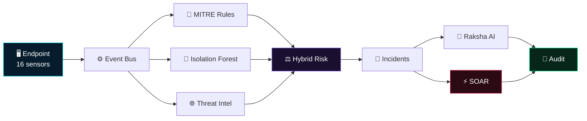

<div align="center">


<a href="https://www.kavachcybertech.in">

</a>

<a href="https://www.kavachcybertech.in"></a>
<br>
<a href="#-quick-start"></a>
<a href="#-documentation"></a>
<br>


</div>


## 🛡️ What is KAVACH?

**KAVACH** (कवच — *shield*) is a unified **AI-driven SOAR + XDR platform**. It watches endpoint behavior, detects threats with rules **and real ML**, correlates evidence into incidents, explains them in plain language, and responds with **controlled, auditable, reversible** actions.

> 🌐 **Official website: [www.kavachcybertech.in](https://www.kavachcybertech.in)**

<div align="center">


</div>




## 🔥 Capabilities

<table>
<tr>
<td width="50%" valign="top">

### 🖥️ XDR
Processes • Network • Files • Registry • Services • PowerShell • Sysmon • Event Logs • DNS • USB

</td>
<td width="50%" valign="top">

### ⚡ SOAR
Isolation • Domain blocking • Process kill • Evidence collection • Ransomware & credential-dump containment

</td>
</tr>
<tr>
<td valign="top">

### 🧠 Behavioral ML
Real `IsolationForest` detection. **No fake scores** — too little data returns `insufficient_data`.

</td>
<td valign="top">

### 🤖 Raksha AI
NVIDIA NIM copilot with local fallback and context sanitization. Explains and recommends; never the source of truth.

</td>
</tr>
<tr>
<td valign="top">

### 🎯 MITRE ATT&CK
Tactic & technique mapping, coverage tracking, SOC heatmaps.

</td>
<td valign="top">

### 🌐 URL Shield
Phishing • Homographs • Punycode • Typosquatting • SSRF • Metadata endpoints

</td>
</tr>
<tr>
<td valign="top">

### ⚔️ Chakra Attack Graph
Animated attack paths, live **blast-radius** calculation, atomic 1-click containment. APT29, Akira & FIN7 scenarios.

</td>
<td valign="top">

### 🏛️ CERT-In Compliance
6-hour statutory timer • auto Annexure-I • 180-day immutable log vault with Merkle proofs • national advisories

</td>
</tr>
<tr>
<td valign="top">

### 🕸️ Mayajaal Deception
Honey files, fake credentials, ghost sockets, registry traps. **Zero false positives**, sub-22ms kill.

</td>
<td valign="top">

### ⚡ Raksha Flow Studio
Drag-and-drop SOAR builder, AI prompt-to-playbook, animated dry-runs, JSON export.

</td>
</tr>
</table>


## 🧬 How It Works

**Every high-impact response follows:** `authorize → dry-run → human approval → execute → audit → rollback`


**AI failure ≠ security failure:** `NVIDIA NIM → local provider → heuristic fallback → KAVACH keeps protecting`

<details>
<summary><b>🛰️ The 16 telemetry engines</b></summary>

| # | Engine | Detects | # | Engine | Detects |
|:-:|---|---|:-:|---|---|
| 01 | 🧠 Process | LOLBins, parent-child anomalies | 09 | 🗂️ Registry | Persistence |
| 02 | 🌐 Network | C2, scanning | 10 | 🔌 USB | Rogue devices |
| 03 | 📁 File Integrity | Ransomware activity | 11 | 🛡️ Defender | Quarantine events |
| 04 | 🔐 Auth | Brute force, RDP anomalies | 12 | ⏰ Tasks | Persistence |
| 05 | 💻 PowerShell | Obfuscation (4104) | 13 | 📦 Software | Vulnerable apps |
| 06 | 🔬 Sysmon | High-fidelity events | 14 | 📊 System | Host baseline |
| 07 | 📜 EventLog | Audit tampering | 15 | 🐤 Canary | Early ransomware |
| 08 | 🌍 DNS | DGA, tunneling | 16 | ⚙️ Services | Service persistence |

</details>

<details>
<summary><b>🏛️ Enterprise core (v2.1.0)</b></summary>

| Subsystem | Highlights | Guide |
|---|---|---|
| 🔐 Zero-Trust Accounts | `REQUESTED → ADMIN_APPROVED → ANALYST_ASSIGNED → ACTIVE`, instant revocation | [Accounts](docs/ACCOUNT_WORKFLOW.md) |
| 🔑 Device Identity | Local RSA-2048, DPAPI-protected key, single-use signed nonces | [Enrollment](docs/DEVICE_ENROLLMENT.md) |
| 📡 Telemetry | Sysmon, EventLog, PowerShell, FIM, DNS, USB & more | [Telemetry](docs/TELEMETRY_DATA_FLOW.md) |
| 🖥️ Windows Companion | Tray guardian, one-click host containment | [Installer](docs/INSTALLER.md) |
| 💾 Safe Migrations | Zero-loss SQLite / PostgreSQL evolution | [Migrations](docs/DATABASE_MIGRATIONS.md) |
| ☁️ AWS Deployment | ECS Fargate, hardened Docker, Secrets Manager, CloudWatch | [Deploy](docs/DEPLOYMENT.md) |
| 🧪 Zero-Mock Tests | 54 pytest tests, 100% pass | [Testing](docs/TESTING.md) |

</details>

<details>
<summary><b>👥 Role-based access</b></summary>

| Capability | 🛡️ SOC Analyst | 👤 Normal User |
|---|:-:|:-:|
| Security score • Alerts • Tips • Raksha AI | ✅ | ✅ |
| Live telemetry • MITRE matrix • Threat hunting | ✅ | ❌ |
| Incident investigation • Collectors | ✅ | ❌ |
| SOAR • Isolation • Quarantine • Evidence | ✅ | ❌ |

</details>


## 🚀 Quick Start

```bash
git clone <YOUR_REPOSITORY_URL> && cd KAVACH/backend
python -m venv venv && venv\Scripts\activate     # Windows
pip install -r requirements.txt
copy .env.example .env                           # add your own keys
python main.py                                   # full XDR mode
python main.py --no-collectors                   # lightweight dev mode
```

```bash
cd frontend && npm install && npm run dev        # React SOC
cd mobile   && flutter pub get && flutter run    # Flutter client
```

> 🔐 Never commit real credentials, API keys, tokens, or passwords.

| Service | Location |
|---|---|
| 🛡️ Backend API | `localhost:8000` |
| 📚 Swagger • ReDoc | `localhost:8000/docs` • `/redoc` |
| 🌐 React SOC | `localhost:5173` |
| 🖥️ Terminal UI | `python tui.py` |

<details>
<summary><b>🔌 API surface</b></summary>

```text
AUTH        POST /api/v1/auth/{register|login|verify-otp}
DASHBOARD   GET  /api/v1/dashboard/summary         WS /api/v1/dashboard/live
ALERTS      GET  /api/v1/alerts                    POST /api/v1/alerts/{id}/explain
INCIDENTS   GET  /api/v1/incidents
THREATS     POST /api/v1/threats/analyze-url
MITRE       GET  /api/v1/mitre/{techniques|heatmap}
SOAR        POST /api/v1/playbooks/execute
RAKSHA AI   POST /api/v1/chatbot/soc
REPORTS     GET  /api/v1/reports/soc
SYSTEM      GET  /api/v1/system/health
CHAKRA      /api/v1/graph/{overview|attack-tree|contain-blast-radius|reset-scenario}
CERT-In     /api/v1/compliance/cert-in/{audit-vault-status|advisories|generate-report|download-annexure|search-vault|mark-reported}
MAYAJAAL    /api/v1/deception/{overview|decoys|deploy|download-canary|tripwire-logs|tripwire/simulate}
RAKSHA FLOW /api/v1/raksha-flow/{workflows|simulate|generate-ai}
```

</details>


## 🧰 Tech Stack

<div align="center">


<br><br>


</div>

## 💡 Principles

🧠 **Evidence first** • 🚫 **No fake ML** • 🛡️ **Fail safe** • 🔐 **Least privilege** • 👤 **Human control** • 📜 **Audit everything** • ↩️ **Rollback**

## 🗺️ Roadmap

- [x] ⚔️ Chakra Attack Graph • ⚡ Raksha Flow Studio • 🏛️ CERT-In Suite • 🕸️ Mayajaal Fleet
- [ ] Multi-host fleet & distributed telemetry
- [ ] Threat-hunting workspace & detection-rule builder
- [ ] Cloud & container telemetry
- [ ] PostgreSQL + high-availability deployment
- [ ] Expanded ATT&CK coverage & TI providers

## 📚 Documentation

[🏛️ Architecture](docs/ARCHITECTURE.md) • [🔐 Accounts](docs/ACCOUNT_WORKFLOW.md) • [🔑 Enrollment](docs/DEVICE_ENROLLMENT.md) • [📡 Telemetry](docs/TELEMETRY_DATA_FLOW.md) • [💾 Migrations](docs/DATABASE_MIGRATIONS.md) • [☁️ Deployment](docs/DEPLOYMENT.md) • [📦 Installer](docs/INSTALLER.md) • [💻 Local Dev](docs/LOCAL_DEVELOPMENT.md) • [🧪 Testing](docs/TESTING.md) • [🔒 Security Review](docs/SECURITY_REVIEW.md) • [📋 Plan](docs/IMPLEMENTATION_PLAN.md) • [🔍 Audit](docs/REPOSITORY_AUDIT.md)

## 📜 License

**Proprietary — All Rights Reserved.** © KAVACH Security Platform. Copying, redistribution, modification, or commercial use is prohibited without explicit authorization from the project owner.

<div align="center">


<br>

<a href="https://www.kavachcybertech.in"></a>

⭐ **If KAVACH is useful, star the repository and follow its evolution.**


</div>
