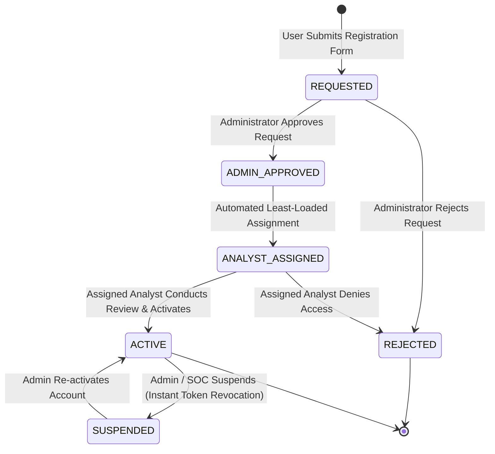

# KAVACH Enterprise Account Lifecycle & Multi-Gate Governance Guide

## 1. Governance Architecture & Philosophy

The KAVACH Cyber Defense Platform implements a **Dual-Gate Zero-Trust Account Lifecycle**. Because endpoint defenders possess privileged telemetry ingestion, response execution (kill process, quarantine file, isolate host), and sensitive log inspection capabilities, account provisioning enforces strict segregation of duties:

1. **Zero Self-Activation**: Self-registration only creates an inert `REQUESTED` record. No user can activate their own account.
2. **Dual-Gate Authorization**:
   - **Gate 1 (Administrative Review)**: An Administrator verifies corporate identity, organization affiliation, and legitimacy.
   - **Gate 2 (SOC Analyst Assignment & Review)**: A dedicated SOC Analyst evaluates host threat telemetry and validates endpoint posture before issuing activation credentials.
3. **Automated Least-Loaded Analyst Workload Distribution**: Ensures fair, bottleneck-free incident and onboarding queue management among SOC analysts.
4. **Immediate Revocation**: Account suspension instantly invalidates all active JWT sessions and revokes associated endpoint credentials.

---

## 2. Lifecycle State Machine



### State Definitions

| State | Allowed Permissions | Next Permitted Transitions | Triggered Actions |
|---|---|---|---|
| `REQUESTED` | None (Cannot log in) | `ADMIN_APPROVED`, `REJECTED` | User submitted form; record queued in Admin Console |
| `ADMIN_APPROVED` | None (Cannot log in) | `ANALYST_ASSIGNED` | Admin approved; system initiates auto-assignment |
| `ANALYST_ASSIGNED` | None (Cannot log in) | `ACTIVE`, `REJECTED` | Assigned analyst notified; queue item added to SOC dashboard |
| `ACTIVE` | Authenticated User / Analyst / Admin | `SUSPENDED` | User can log in and enroll up to 5 endpoints |
| `REJECTED` | None (Blocked) | None | Terminal state; rejection reason logged to audit trail |
| `SUSPENDED` | None (Session revoked) | `ACTIVE` | Sessions invalidated immediately; endpoints cannot ship telemetry |

---

## 3. Least-Loaded Analyst Assignment Algorithm

When an administrator approves a request, the system auto-assigns the request to the least-burdened active SOC analyst using the algorithm implemented in `backend/app/services/account_service.py`:

```python
# 1. Query all active users with role 'soc_analyst'
analysts = await session.execute(
    select(User).where((User.role == "soc_analyst") & (User.status == "ACTIVE") & (User.is_active == True))
)

# 2. Count active assigned requests per analyst
workloads = {
    analyst.id: await get_active_assignment_count(session, analyst.id)
    for analyst in analysts
}

# 3. Find minimum workload count
min_workload = min(workloads.values())

# 4. Randomized tie-breaker among analysts sharing the minimum workload
eligible_analysts = [a_id for a_id, count in workloads.items() if count == min_workload]
selected_analyst_id = secrets.choice(eligible_analysts)
```

**Benefits:**
- Prevents queue concentration on a single senior analyst.
- Mitigates predictable analyst targeting by threat actors.
- Preserves a complete audit trail in the `analyst_assignment_history` table.

---

## 4. REST API Endpoint Specifications

### 4.1 Request Account Access
- **Endpoint**: `POST /api/v1/account/request-access`
- **Access**: Public (Unauthenticated)
- **Request Body**:
  ```json
  {
    "full_name": "Jane Doe",
    "email": "jane.doe@enterprise.com",
    "organization_name": "Acme Cyber Defense",
    "department": "Security Operations",
    "reason": "Monitored workstation deployment"
  }
  ```
- **Response**: `201 Created`

### 4.2 Query Account Approval Status
- **Endpoint**: `GET /api/v1/account/status?email=jane.doe@enterprise.com`
- **Access**: Public (Unauthenticated)
- **Response**: `200 OK`
  ```json
  {
    "status": "ANALYST_ASSIGNED",
    "email": "jane.doe@enterprise.com",
    "assigned_analyst_name": "Alex Mercer (SOC Lead)",
    "created_at": "2026-10-15T16:00:00Z"
  }
  ```

### 4.3 Administrator Approval & Reassignment
- **Endpoint**: `POST /api/v1/account/admin/approve/{request_id}`
- **Access**: Admin Role Only (`Bearer <jwt>`)
- **Request Body**: `{"notes": "Verified corporate identity"}`

### 4.4 SOC Analyst Activation
- **Endpoint**: `POST /api/v1/account/analyst/activate/{request_id}`
- **Access**: Assigned Analyst or Admin (`Bearer <jwt>`)
- **Request Body**: `{"notes": "Verified host telemetry baseline"}`
- **Response**: Account activated; initial temporary credentials generated and emailed.

### 4.5 Account Suspension & Instant Session Revocation
- **Endpoint**: `POST /api/v1/account/admin/suspend/{user_id}`
- **Access**: Admin Role Only (`Bearer <jwt>`)
- **Action**: Sets `status = 'SUSPENDED'`, stamps `session_revoked_at = utcnow()`, and revokes all active DPAPI device credentials.
