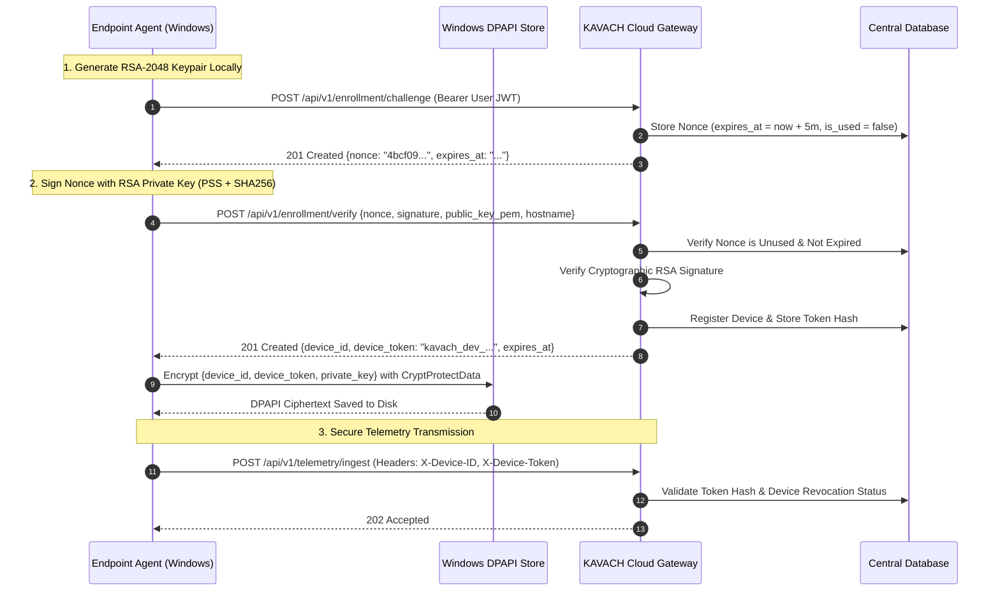

# KAVACH Cryptographic Device Identity & Endpoint Enrollment Guide

## 1. Zero-Trust Endpoint Architecture

In conventional endpoint detection platforms, endpoints authenticate using shared pre-shared keys (PSKs) or static API tokens. If an attacker extracts a static token from memory or disk, they can spoof telemetry or inject forged clean events to blind the SOC.

KAVACH eliminates static credentials through **Cryptographic Challenge-Response Device Enrollment**:
1. **Local Key Generation**: The endpoint agent generates an RSA-2048 keypair locally upon first launch. The private key never leaves the physical endpoint.
2. **Hardware Protection**: On Windows endpoints, the private key and session token are encrypted at rest using the **Windows Data Protection API (DPAPI)** via `CryptProtectData`. On Linux/macOS, authenticated AES-256-GCM encryption is utilized.
3. **Challenge-Response Attestation**: The cloud issues a single-use 64-character cryptographic challenge nonce with a 5-minute time-to-live (TTL). The endpoint signs the nonce using its private key (`SHA-256 with PSS padding`).
4. **Device Session Issuance**: Upon signature verification, the server issues a scoped device credential (`kavach_dev_<token>`) stored as a SHA-256 hash in the database.
5. **Periodic Rotation & Immediate Revocation**: Device credentials automatically rotate every 90 days and can be revoked immediately by the user or SOC analyst.

---

## 2. Cryptographic Enrollment Protocol Sequence



---

## 3. Windows DPAPI Implementation Details

The KAVACH agent accesses the Windows Cryptography API (`crypt32.dll`) via native Python `ctypes`:

```python
import ctypes
from ctypes import wintypes

class DATA_BLOB(ctypes.Structure):
    _fields_ = [
        ("cbData", wintypes.DWORD),
        ("pbData", ctypes.POINTER(ctypes.c_byte)),
    ]

def dpapi_protect(data: bytes, description: str = "") -> bytes:
    # Invokes CryptProtectData
    # Uses currentUser credential ring (CRYPTPROTECT_UI_FORBIDDEN = 0x1)
    ...
```

**Key Security Properties:**
- Encryption keys are derived dynamically from the logged-in Windows user's password and machine GUID.
- Offline disk extraction by an unauthorized user cannot decrypt the private key or device token.
- Memory protection wipes sensitive byte arrays after file writing.

---

## 4. Replay Attack & Tamper Resistance

1. **Single-Use Nonces**: Once a nonce is verified, `is_used` is set to `True`. Any replayed verification request with the same nonce fails with `422 Unprocessable Entity` ("Enrollment challenge has already been used").
2. **5-Minute Expiry**: Nonces older than 300 seconds are rejected with `ValidationError` ("Enrollment challenge has expired").
3. **Session Binding**: The challenge requester's JWT user ID must match the verification session.
4. **Device Quotas**: Each active non-admin account is strictly capped at **5 active devices** to prevent enterprise account abuse.
