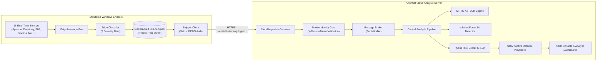

# KAVACH Telemetry Data Flow & Sensor Architecture Guide

## 1. End-to-End Pipeline Architecture

---

## 2. The 16 Endpoint Telemetry Collectors

| # | Sensor Name | Source / Technology | Telemetry Captured |
|---|---|---|---|
| 1 | `ProcessCollector` | Windows WMI / PSUtil | Process creation, parent-child trees, command-line arguments, hashes |
| 2 | `NetworkCollector` | TCP/UDP sockets & Netstat | Outbound sockets, listening ports, remote IPs, connection duration |
| 3 | `FileMonitorCollector` | Windows ReadDirectoryChangesW / Watchdog | File integrity monitoring (FIM), file creation, deletion, modification |
| 4 | `LoginCollector` | Windows Security Event Log (ID 4624/4625) | Interactive logons, RDP connections, failed authentication brute-force |
| 5 | `PowerShellCollector` | Windows PowerShell Operational Log (ID 4104) | Script block logging, encoded command execution, AMSI bypass attempts |
| 6 | `ServiceCollector` | Windows Service Control Manager (SCM) | New service creation, service state changes, binary path modifications |
| 7 | `USBCollector` | Windows PnP Device Notification | USB drive insertion, hardware ID, serial number, unauthorized storage |
| 8 | `DefenderCollector` | Windows Defender Event Log (ID 1116/1117) | Malware detections, signature updates, quarantined threats |
| 9 | `DNSCollector` | Windows DNS Client Event Log / ETW | DNS lookup queries, fast-flux domains, DGA detection, C2 resolution |
| 10 | `RegistryCollector` | Windows Registry Run / Polling | Persistence keys (`Run`, `RunOnce`, `Services`, `Image File Execution Options`) |
| 11 | `ScheduledTaskCollector` | Windows Task Scheduler Log (ID 106/140) | Task creation, scheduled persistence, suspicious command triggers |
| 12 | `SoftwareCollector` | Windows MSI & Uninstall Registry | Software installation, version changes, unapproved application additions |
| 13 | `SystemInfoCollector` | Windows Kernel / WMI | CPU load, memory utilization, disk space, host vitals snapshot |
| 14 | `SysmonCollector` | Microsoft System Monitor (Sysmon) | High-fidelity process injection, raw disk access, driver loads |
| 15 | `CanaryCollector` | KAVACH Decoy Files | Ransomware early-warning tripwire canary file modifications |
| 16 | `WindowsEventLogCollector` | Windows Security/System/Application logs | Critical kernel security events, audit policy changes, clearing of logs |

---

## 3. Edge Severity Classification (5 Tiers)

Every raw telemetry event is classified locally on the edge before spooling:

| Tier | Priority Code | Definition | Dispatch Behavior |
|---|---|---|---|
| **P1: CRITICAL** | 1 | Confirmed ransomware, credential dumping (LSASS), active exploit | Immediate dispatch: signals shipper to wake up instantly |
| **P2: HIGH** | 2 | C2 beaconing, unauthorized privilege escalation, AMSI bypass | Immediate dispatch |
| **P3: MEDIUM** | 3 | New unsigned service installation, suspicious registry key | Batched dispatch (every 3 seconds) |
| **P4: LOW** | 4 | Routine process start, standard network connection, file read | Batched dispatch |
| **P5: STATISTICAL** | 5 | Host vitals (CPU/RAM/Disk), periodic heartbeat | Batched dispatch (every 45 seconds) |

---

## 4. Resilient Offline Spooling & Zero-Loss Shipping

- **SQLite WAL Mode**: The local buffer (`agent_spool.db`) uses Write-Ahead Logging (`PRAGMA journal_mode = WAL`) and normal synchronization for sub-millisecond writes without blocking collectors.
- **Priority Dequeue**: Spool events are indexed by `(tier_priority, id)` so that Critical and High events are guaranteed transmission first, even when recovering from network disconnections.
- **Bounded Storage Cap**: If the offline queue exceeds 250MB, oldest low/statistical events are pruned automatically to protect workstation disk capacity.
- **Payload Compression**: Batches exceeding 50 events are automatically Gzip-compressed before HTTPS transmission.
